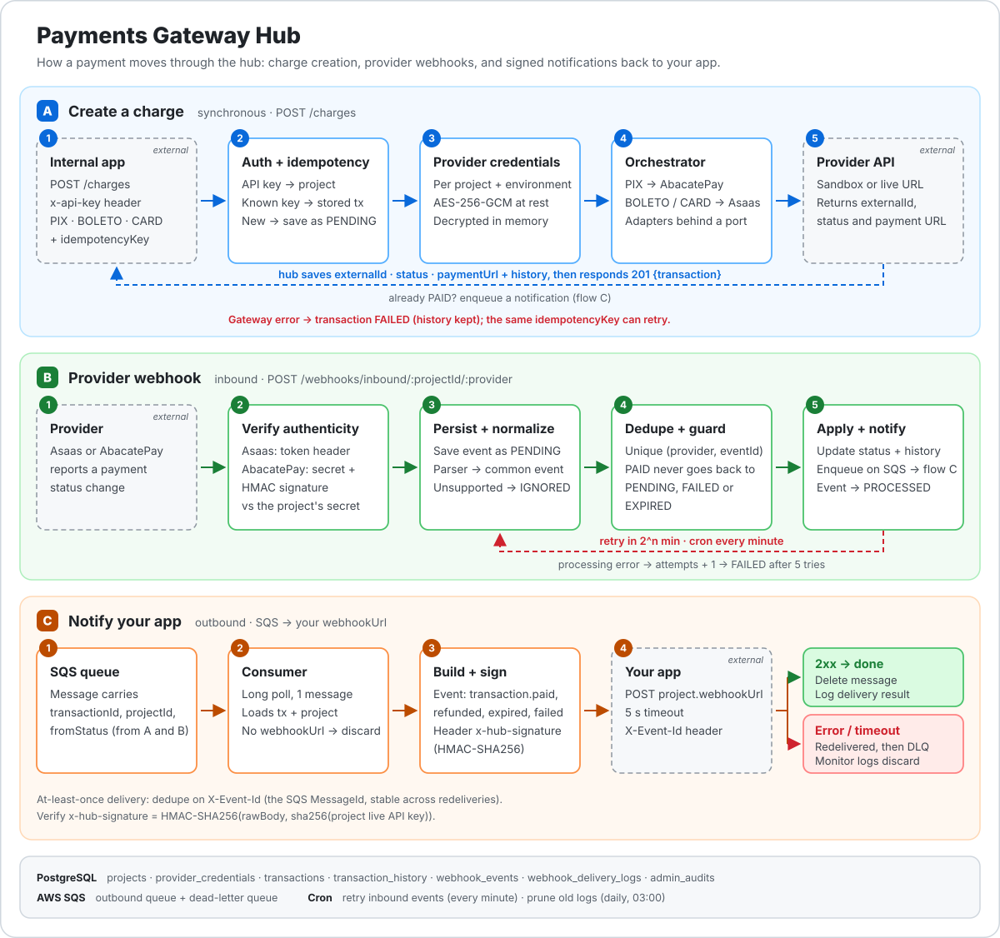
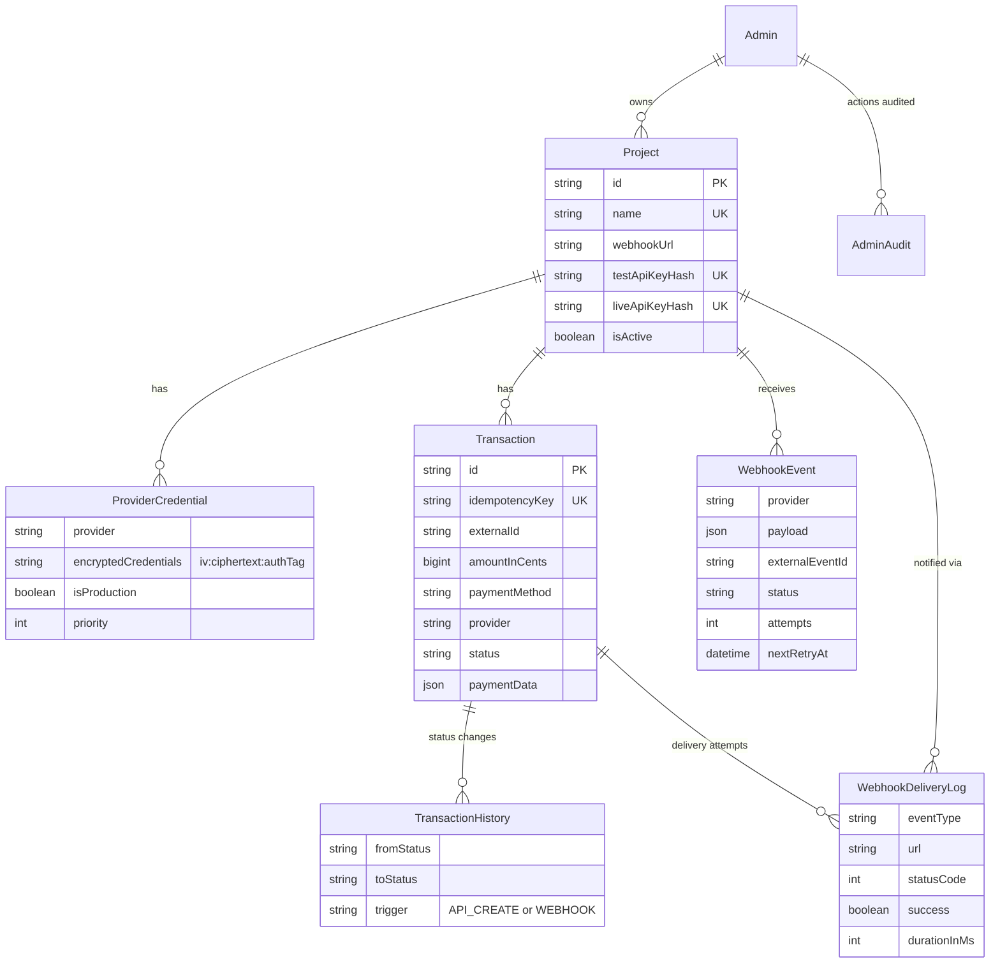
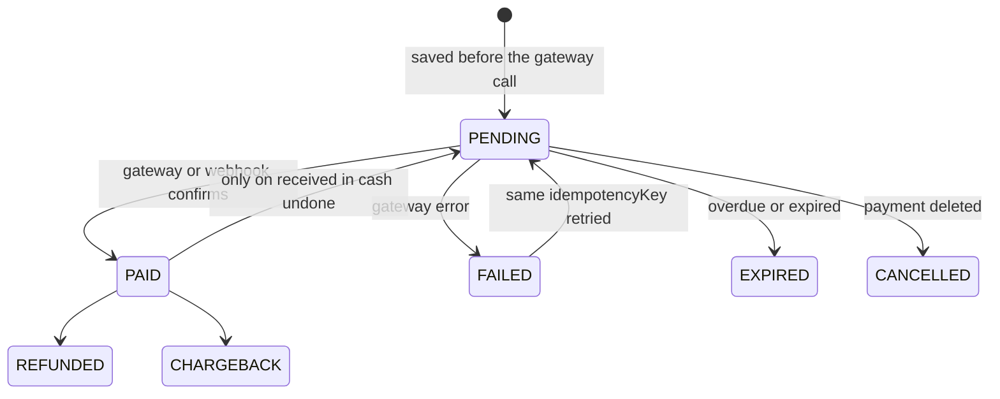
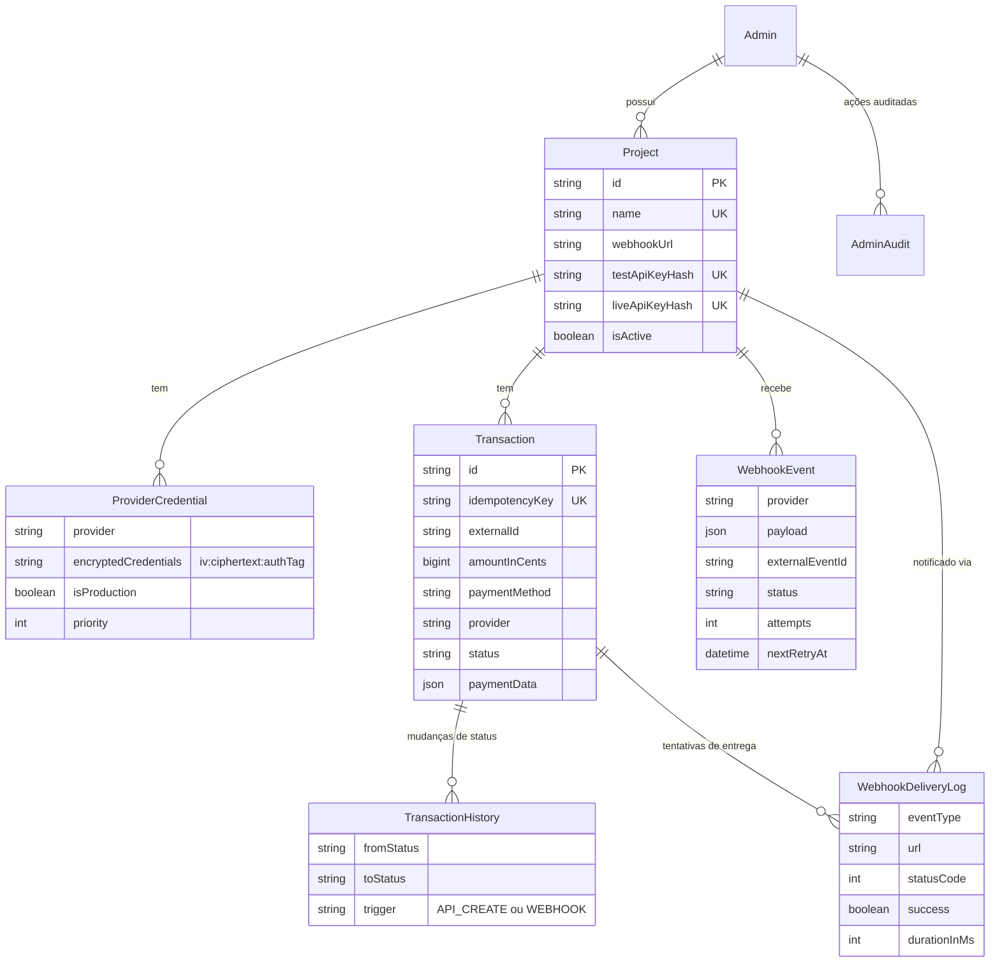
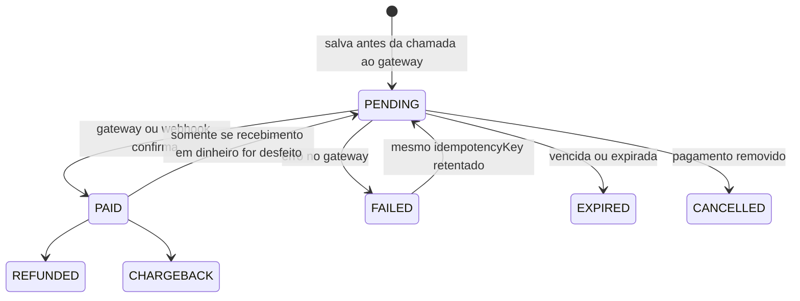

# Payments Gateway Hub

> One API between your internal projects and multiple payment gateways. Pix goes to **AbacatePay**, Boleto and credit card go to **Asaas**, and every status change reaches your app as a signed webhook.


**English** · [Português](#português)

## The problem

When several internal applications each integrate with their own payment provider, every one of them re-implements the same hard parts: idempotent charge creation, webhook authenticity, duplicated or out-of-order events, retries and an audit trail. This hub centralizes them.

Your apps talk to **one** API. The hub owns provider credentials, picks the right gateway, normalizes provider events into a common model, and notifies your app asynchronously.

## How it works



1. **Create a charge (synchronous).** The app calls `POST /charges` with its project API key. The hub authenticates, checks idempotency, saves the transaction as `PENDING` **before** calling anything external, decrypts the project's provider credentials, and lets the orchestrator route by payment method (`PIX` → AbacatePay, `BOLETO` / `CREDIT_CARD` → Asaas). The result is stored and returned with the payment URL.
2. **Provider webhook (inbound).** The provider reports a status change to `POST /webhooks/inbound/:projectId/:provider`. The hub verifies the request, persists the raw event, normalizes it, drops duplicates and stale transitions, updates the transaction and enqueues a notification. Processing errors are retried with exponential backoff.
3. **Notify your app (outbound).** A consumer reads the SQS queue, builds an event, signs it with HMAC-SHA256 and posts it to the project's `webhookUrl`. Every attempt is logged; messages that keep failing end up in a dead-letter queue.

## Features

- **Unified charge API** for Pix, Boleto and credit card, with method-to-provider routing in a single orchestrator.
- **Idempotent by design.** A repeated `idempotencyKey` returns the stored transaction; a `FAILED` one can be retried with the same key.
- **Projects with test and live API keys.** Keys are SHA-256 hashed at rest and shown only once, at project creation.
- **Provider credentials encrypted at rest** (AES-256-GCM), one set per project, provider and environment. Provider keys are never read from environment variables at charge time.
- **Resilient inbound webhooks:** per-provider verification and parsing, deduplication on `(provider, externalEventId)`, a guard that stops a `PAID` transaction from regressing, and a retry worker with exponential backoff.
- **Signed outbound webhooks** delivered through SQS, with a delivery log per attempt and a DLQ monitor.
- **Audit trail:** `transaction_history` records every status change and what triggered it (API or webhook), delivery logs record every notification attempt, and backoffice actions are recorded in an admin audit table.
- **Operational basics:** structured logs (pino) with correlation ids and a redacted `x-api-key`, environment validation at boot, a global exception filter, scheduled pruning of old logs, and Swagger docs outside production.

## Tech stack

| Area | Choice |
| --- | --- |
| Runtime / framework | Node.js 20+, NestJS 10 (Express), TypeScript, SWC build |
| Persistence | PostgreSQL, Prisma 7 with the `pg` driver adapter |
| Messaging | AWS SQS (SDK v3), LocalStack for local development and tests |
| Validation / docs | class-validator, class-transformer, Swagger (OpenAPI) |
| Auth | API keys (SHA-256 hashed) for projects, JWT + bcrypt for admins |
| Scheduling | `@nestjs/schedule` (retry worker, log pruning) |
| Observability | nestjs-pino |
| Testing | Vitest, Supertest, in-memory repository mocks and entity builders |
| Tooling | pnpm, ESLint, Prettier, Husky + lint-staged |

## Architecture

The code follows Clean / Hexagonal Architecture. Use cases depend on **ports** (abstract classes); adapters implement them, so gateways, queues, crypto and repositories can be swapped or mocked without touching business rules.

```
src/
  core/         domain primitives (Entity, ValueObject, MoneyVo), enums, use-case contract
  shared/       auth guards, env validation, database, HTTP client, pipes, swagger
  modules/
    backoffice/ projects, API keys, provider credentials, admin auth, audit
    payments/   charges: use cases, orchestrator, gateway adapters
    webhooks/   inbound pipeline, SQS producer / consumer, DLQ monitor, workers
prisma/         schema, migrations, seed
tests/          __unit__, __integration__, __e2e__, data/{builders,mocks}
scripts/        e2e and integration runners, LocalStack setup
```

Each module is layered the same way: `application/` (use cases with co-located controller + swagger, DTOs, ports), `domain/` (entities and repository contracts) and `infra/` (adapters, Prisma repositories, guards).

| Port | Adapters |
| --- | --- |
| `IPaymentGatewayPort` | `AbacatePayPaymentGatewayAdapter`, `AsaasPaymentGatewayAdapter` |
| `IWebhookParserPort` | `AbacatePayWebhookParser`, `AsaasWebhookParser` |
| `IWebhookSignatureStrategy` | `AbacatePaySignatureStrategy`, `AsaasSignatureStrategy` |
| `IWebhookQueueProducerPort` | `SqsWebhookProducerAdapter` |
| `IWebhookProvisioningPort` | `AsaasWebhookProvisioningAdapter` |
| `IEncryptionServicePort` | `AesEncryptionServiceAdapter` |
| `ITokenService` | `JwtTokenServiceAdapter` |
| `I*Repository` | `PgSql*Repository` (Prisma) |

### Adding a provider

1. Implement `IPaymentGatewayPort` in `payments/infra/adapters/payment-gateways/` and register it in `PaymentsModule` under a named provider token.
2. Inject it in `PaymentOrchestratorService`, add the routing case, and map the method to the provider in `CreateChargeUseCase.predictPaymentProvider`.
3. Add the provider to `EPaymentProvider`.
4. For webhooks: add an `IWebhookParserPort` and an `IWebhookSignatureStrategy`, and list them in the `WEBHOOK_PARSERS` and `WEBHOOK_SIGNATURE_STRATEGIES` providers of `WebhooksModule`.

## Data model



### Transaction lifecycle



Once a transaction is `PAID`, stale webhooks cannot move it back to `PENDING`, `FAILED` or `EXPIRED` (the single exception is Asaas' `PAYMENT_RECEIVED_IN_CASH_UNDONE`).

## API

Interactive docs are served at `http://localhost:3000/api` whenever `NODE_ENV` is not `production`.

| Method | Path | Auth | Purpose |
| --- | --- | --- | --- |
| `POST` | `/charges` | `x-api-key` | Create a charge (Pix, Boleto, credit card) |
| `GET` | `/charges` | `x-api-key` (own project) or admin JWT | List charges, or look one up by `idempotencyKey`. Query: `idempotencyKey`, `projectId`, `page`, `limit` (max 100) |
| `POST` | `/webhooks/inbound/:projectId/:provider` | provider secret | Receive provider webhooks. `provider` is `asaas` or `abacatepay` |
| `HEAD` | `/webhooks/inbound/:projectId/:provider` | none | Reachability check for provider webhook setup |
| `POST` | `/backoffice/auth/login` | none | Admin login, returns a JWT (24 h) |
| `POST` | `/backoffice/projects` | admin JWT | Create a project; returns its test and live API keys **once** |
| `POST` | `/backoffice/projects/:projectId/provider-credentials` | admin JWT | Create or update encrypted provider credentials |
| `GET` | `/backoffice/audit/transactions/:id` | admin JWT | Transaction audit summary (`searchBy=transactionId` or `externalId`) |
| `GET` | `/backoffice/audit-logs` | admin JWT | Admin action audit log |

### Create a Pix charge

```bash
curl -X POST http://localhost:3000/charges \
  -H "x-api-key: sk_test_..." \
  -H "Content-Type: application/json" \
  -d '{
    "amountInCents": 10000,
    "currency": "BRL",
    "idempotencyKey": "order-42",
    "paymentMethod": "PIX",
    "isProduction": false,
    "details": {
      "productName": "Pro plan",
      "returnUrl": "https://app.example.com/return",
      "completionUrl": "https://app.example.com/done",
      "customer": {
        "name": "Jane Doe",
        "email": "jane@example.com",
        "cellphone": "+5511999999999",
        "taxId": "11144477735"
      }
    }
  }'
```

`201 Created` (trimmed):

```json
{
  "transaction": {
    "id": "cm...",
    "idempotencyKey": "order-42",
    "externalId": "bill_...",
    "provider": "abacatepay",
    "paymentMethod": "PIX",
    "status": "PENDING",
    "amount": { "value": 10000, "currency": "BRL", "formatted": "R$ 100,00" },
    "paymentUrl": "https://...",
    "paymentData": {}
  }
}
```

- `isProduction` (default `false`) selects the sandbox or production credentials and provider URL.
- **Boleto** takes `details.customer`, plus optional `dueDate` (`YYYY-MM-DD`, default: 3 days ahead) and `description`.
- **Credit card** takes `details.customer` (with `postalCode` and `addressNumber` recommended for Asaas), `details.card` (`holderName`, `number`, `expiryMonth`, `expiryYear`, `cvv`) and an optional `description`.
- `cellphone` is validated as a Brazilian phone number.

### Set up a project

```bash
# 1. Log in as the seeded admin
curl -X POST http://localhost:3000/backoffice/auth/login \
  -H "Content-Type: application/json" \
  -d '{ "email": "admin@example.com", "password": "..." }'      # -> { admin, token }

# 2. Create a project (webhookUrl is where the hub will notify your app)
curl -X POST http://localhost:3000/backoffice/projects \
  -H "Authorization: Bearer <token>" -H "Content-Type: application/json" \
  -d '{ "name": "checkout", "webhookUrl": "https://app.example.com/hooks/payments" }'
                                                               # -> testApiKey / liveApiKey, shown once

# 3. Store the provider credentials for that project
curl -X POST http://localhost:3000/backoffice/projects/<projectId>/provider-credentials \
  -H "Authorization: Bearer <token>" -H "Content-Type: application/json" \
  -d '{
    "provider": "asaas",
    "credentials": { "apiKey": "<provider api key>", "webhookSecret": "<shared secret>" },
    "priority": 1,
    "isProduction": false
  }'
```

`priority` is `1` (high), `2` (medium) or `3` (low). For **Asaas**, saving the credentials also registers the webhook at Asaas, pointing to `${BASE_URL}/webhooks/inbound/<projectId>/asaas`. For **AbacatePay**, configure `${BASE_URL}/webhooks/inbound/<projectId>/abacatepay` in the provider dashboard. In both cases `webhookSecret` must match the secret configured at the provider.

## Webhooks sent to your app

The hub posts to the project's `webhookUrl`:

```json
{
  "eventId": "6f1c...",
  "eventType": "transaction.paid",
  "timestamp": "2026-01-01T12:00:00.000Z",
  "status": "PAID",
  "idempotencyKey": "order-42",
  "data": {
    "transactionId": "cm...",
    "paymentMethod": "PIX",
    "amount": { "value": 10000, "currency": "BRL", "formatted": "R$ 100,00" },
    "provider": { "id": "bill_...", "name": "abacatepay", "status": "PAID" },
    "customer": { "email": "jane@example.com", "taxId": "11144477735" },
    "resources": { "paymentUrl": "https://..." },
    "metadata": {}
  }
}
```

| Event type | Meaning |
| --- | --- |
| `transaction.created` | Transaction is `PENDING` |
| `transaction.paid` | Payment confirmed |
| `transaction.refunded` | Payment refunded |
| `transaction.expired` | Payment overdue or expired |
| `transaction.cancelled` | Payment deleted at the provider |
| `transaction.failed` | Payment failed |
| `transaction.chargeback` | Chargeback requested |
| `transaction.reverted` | A `PAID` payment went back to `PENDING` |

**Headers:** `x-hub-signature`, `X-Event-Id`, `Content-Type: application/json`.

**Verify the signature** with the SHA-256 digest of your project's **live** API key as the HMAC secret, over the raw request body:

```ts
import { createHash, createHmac, timingSafeEqual } from 'node:crypto';

function isValid(rawBody: Buffer, signature: string, liveApiKey: string): boolean {
  const secret = createHash('sha256').update(liveApiKey).digest('hex');
  const expected = createHmac('sha256', secret).update(rawBody).digest('hex');
  return (
    expected.length === signature.length &&
    timingSafeEqual(Buffer.from(expected), Buffer.from(signature))
  );
}
```

**Delivery semantics:** at-least-once. Respond with a `2xx` within 5 seconds. Anything else leaves the message in the queue to be redelivered, and messages that keep failing move to the dead-letter queue. Deduplicate on `X-Event-Id`, which is the SQS message id and stays the same across redeliveries.

## Getting started

**Prerequisites:** Node.js 20+, pnpm, Docker, and the AWS CLI (used by the LocalStack scripts).

```bash
pnpm install
cp .env.sample .env.dev        # then fill in the values below
```

### Environment variables

| Variable | Description |
| --- | --- |
| `NODE_ENV` | `development`, `staging`, `production` or `testing` |
| `PORT` | HTTP port (default `3000`) |
| `PG_USER`, `PG_PASSWORD`, `PG_HOST`, `PG_PORT`, `PG_DATABASE` | PostgreSQL connection parts (used by Docker Compose and env validation) |
| `DATABASE_URL` | PostgreSQL connection string used by Prisma |
| `ENCRYPTION_MASTER_KEY` | 32 bytes as 64 hex chars: `node -e "console.log(require('crypto').randomBytes(32).toString('hex'))"` |
| `JWT_SECRET` | Secret used to sign admin tokens |
| `ADMIN_EMAIL`, `ADMIN_PASSWORD` | Admin created by the seed; the email is also used as the notification address when the hub registers an Asaas webhook |
| `BASE_URL` | Public URL of this service, used to build provider webhook URLs |
| `AWS_REGION`, `AWS_ACCESS_KEY_ID`, `AWS_SECRET_ACCESS_KEY` | AWS credentials (any dummy values work with LocalStack) |
| `AWS_SQS_QUEUE_OUTBOUND_URL` | Outbound notification queue |
| `AWS_SQS_QUEUE_OUTBOUND_DLQ_URL` | Dead-letter queue monitored by the hub |
| `AWS_ENDPOINT_URL` | Optional. Point to `http://localhost:4566` to use LocalStack |
| `ABACATEPAY_API_KEY` | Required by the env schema but not read elsewhere. Provider keys live in the database, per project |

### Local infrastructure

```bash
# PostgreSQL only
docker compose up -d

# PostgreSQL (port 5433) + LocalStack, as used by the test suites
docker compose -f docker-compose.test.yml up -d
./scripts/setup-localstack.sh   # creates the outbound queue
```

The hub also polls a dead-letter queue, so create one and attach it to the outbound queue with a redrive policy (example for LocalStack; adjust names and `maxReceiveCount`):

```bash
aws --endpoint-url=http://localhost:4566 --region us-east-1 sqs create-queue \
  --queue-name webhooks-outbound-dlq

aws --endpoint-url=http://localhost:4566 --region us-east-1 sqs set-queue-attributes \
  --queue-url http://localhost:4566/000000000000/webhooks-outbound-queue-test \
  --attributes '{"RedrivePolicy":"{\"deadLetterTargetArn\":\"arn:aws:sqs:us-east-1:000000000000:webhooks-outbound-dlq\",\"maxReceiveCount\":\"5\"}"}'
```

Then set `AWS_SQS_QUEUE_OUTBOUND_URL` and `AWS_SQS_QUEUE_OUTBOUND_DLQ_URL` accordingly.

### Run

```bash
pnpm db:push:dev      # apply the Prisma schema
pnpm db:seed:dev      # create the admin from ADMIN_EMAIL / ADMIN_PASSWORD
pnpm start:dev        # build + watch mode, Swagger at /api
```

Production build: `pnpm build && pnpm start:prod`.

## Testing

```bash
pnpm test:unit            # no external services, in-memory mocks and builders
pnpm test:integration     # real PostgreSQL: adapters, encryption, pruning worker
pnpm test:e2e             # HTTP + PostgreSQL + LocalStack, single fork
pnpm test:cov             # coverage

./scripts/e2e-tests.sh    # boots Postgres + LocalStack + queue, applies schema and seed, runs e2e
```

The suite has 40 spec files across the three layers. Unit tests exercise use cases, entities, value objects, parsers, signature strategies, guards, the SQS producer / consumer and the workers against in-memory doubles. The e2e specs drive the full HTTP flow with Supertest, including a Pix charge confirmed through a signed webhook. Integration and e2e runs that reach provider sandboxes read `ABACATEPAY_API_KEY` and `ASAAS_API_KEY` from `.env.test`.

## Design decisions

- **Persist, then call out.** The `PENDING` transaction and its history row exist before any provider request, so a crash mid-call never loses the idempotency key.
- **Credentials in the database, not the environment.** Each project brings its own provider accounts, per environment. Encryption is AES-256-GCM, so tampering with a stored value is detected on decrypt.
- **API keys are hashed, never stored.** Lookup is by SHA-256; the plain key is returned a single time.
- **Providers stay at the edge.** Parsers translate provider payloads into one `NormalizedWebhookEvent`, so the transaction logic never sees provider-specific shapes.
- **Monotonic status for paid transactions.** Out-of-order and replayed webhooks cannot downgrade a `PAID` transaction.
- **Queue between the state change and the notification.** Delivery latency and your app's availability never block provider webhooks or charge creation.
- **Ports everywhere.** Use cases are unit-tested without a database or network.

## Known limitations and roadmap

- **AbacatePay signature enforcement.** The strategy checks the shared secret and the HMAC, but currently logs an HMAC mismatch and still accepts the request (see the TODO in `abacate-pay-signature.strategy.ts`). Make it strict before production.
- **No transactional outbox.** The status update and the SQS enqueue are separate steps, so a failed enqueue after the update is not re-sent by the inbound retry.
- **Card data passes through the hub** in the request body, which puts the service in PCI scope. For production, prefer provider tokenization or hosted checkout.
- **Workers run inside the API process** (SQS consumer, DLQ monitor, cron jobs). With several replicas, the retry worker needs a claim or lock.
- **Outbound retry timing** comes from the queue's visibility timeout and redrive policy, which are configured on the queue, not in code.
- **Providers:** `payoneer` exists in the enum without an adapter; Stripe and subscriptions are not implemented yet.
- **Schema sync** uses `prisma db push`; a `prisma/migrations` history is included for reference.

## License

MIT

---

## Português

[English](#payments-gateway-hub) · **Português**

> Uma única API entre seus projetos internos e vários gateways de pagamento. Pix vai para a **AbacatePay**, Boleto e cartão de crédito vão para a **Asaas**, e toda mudança de status chega ao seu app como um webhook assinado.

### O problema

Quando várias aplicações internas integram cada uma com o seu próprio provedor de pagamento, todas reimplementam as mesmas partes difíceis: criação idempotente de cobranças, autenticidade de webhooks, eventos duplicados ou fora de ordem, retentativas e trilha de auditoria. Este hub centraliza tudo isso.

Seus apps falam com **uma** API. O hub guarda as credenciais dos provedores, escolhe o gateway certo, normaliza os eventos dos provedores em um modelo comum e notifica o seu app de forma assíncrona.

### Como funciona


*Os rótulos do diagrama estão em inglês.*

1. **Criar uma cobrança (síncrono).** O app chama `POST /charges` com a API key do projeto. O hub autentica, verifica a idempotência, salva a transação como `PENDING` **antes** de chamar qualquer serviço externo, descriptografa as credenciais do projeto no provedor e deixa o orquestrador rotear pelo método de pagamento (`PIX` → AbacatePay, `BOLETO` / `CREDIT_CARD` → Asaas). O resultado é armazenado e devolvido com a URL de pagamento.
2. **Webhook do provedor (entrada).** O provedor informa uma mudança de status em `POST /webhooks/inbound/:projectId/:provider`. O hub verifica a requisição, persiste o evento bruto, normaliza, descarta duplicados e transições obsoletas, atualiza a transação e enfileira uma notificação. Erros de processamento são retentados com backoff exponencial.
3. **Notificar seu app (saída).** Um consumidor lê a fila SQS, monta um evento, assina com HMAC-SHA256 e envia via POST para o `webhookUrl` do projeto. Cada tentativa é registrada; mensagens que continuam falhando vão para uma dead-letter queue.

### Funcionalidades

- **API unificada de cobranças** para Pix, Boleto e cartão de crédito, com roteamento método-provedor em um único orquestrador.
- **Idempotente por design.** Um `idempotencyKey` repetido devolve a transação armazenada; uma transação `FAILED` pode ser retentada com a mesma chave.
- **Projetos com API keys de teste e de produção (live).** As chaves são armazenadas como hash SHA-256 e exibidas uma única vez, na criação do projeto.
- **Credenciais dos provedores criptografadas em repouso** (AES-256-GCM), um conjunto por projeto, provedor e ambiente. As chaves dos provedores nunca são lidas de variáveis de ambiente na hora de cobrar.
- **Webhooks de entrada resilientes:** verificação e parsing por provedor, deduplicação em `(provider, externalEventId)`, uma proteção que impede uma transação `PAID` de regredir e um worker de retentativas com backoff exponencial.
- **Webhooks de saída assinados**, entregues via SQS, com log de entrega por tentativa e um monitor de DLQ.
- **Trilha de auditoria:** `transaction_history` registra cada mudança de status e o que a originou (API ou webhook), os delivery logs registram cada tentativa de notificação e as ações do backoffice ficam em uma tabela de auditoria de admins.
- **Básico operacional:** logs estruturados (pino) com correlation ids e `x-api-key` mascarada, validação de ambiente no boot, filtro global de exceções, limpeza agendada de logs antigos e docs Swagger fora de produção.

### Stack

| Área | Escolha |
| --- | --- |
| Runtime / framework | Node.js 20+, NestJS 10 (Express), TypeScript, build com SWC |
| Persistência | PostgreSQL, Prisma 7 com o driver adapter `pg` |
| Mensageria | AWS SQS (SDK v3), LocalStack para desenvolvimento local e testes |
| Validação / docs | class-validator, class-transformer, Swagger (OpenAPI) |
| Autenticação | API keys (hash SHA-256) para projetos, JWT + bcrypt para admins |
| Agendamento | `@nestjs/schedule` (worker de retentativas, limpeza de logs) |
| Observabilidade | nestjs-pino |
| Testes | Vitest, Supertest, mocks de repositório em memória e builders de entidades |
| Ferramentas | pnpm, ESLint, Prettier, Husky + lint-staged |

### Arquitetura

O código segue Clean / Hexagonal Architecture. Os casos de uso dependem de **ports** (classes abstratas); os adapters as implementam, de modo que gateways, filas, criptografia e repositórios podem ser trocados ou mockados sem tocar nas regras de negócio.

```
src/
  core/         primitivas de domínio (Entity, ValueObject, MoneyVo), enums, contrato de use case
  shared/       guards de auth, validação de env, banco, cliente HTTP, pipes, swagger
  modules/
    backoffice/ projetos, API keys, credenciais de provedores, auth de admin, auditoria
    payments/   cobranças: use cases, orquestrador, adapters de gateway
    webhooks/   pipeline de entrada, producer / consumer SQS, monitor de DLQ, workers
prisma/         schema, migrations, seed
tests/          __unit__, __integration__, __e2e__, data/{builders,mocks}
scripts/        runners de e2e e integração, setup do LocalStack
```

Cada módulo segue as mesmas camadas: `application/` (use cases com controller + swagger no mesmo lugar, DTOs, ports), `domain/` (entidades e contratos de repositório) e `infra/` (adapters, repositórios Prisma, guards).

| Port | Adapters |
| --- | --- |
| `IPaymentGatewayPort` | `AbacatePayPaymentGatewayAdapter`, `AsaasPaymentGatewayAdapter` |
| `IWebhookParserPort` | `AbacatePayWebhookParser`, `AsaasWebhookParser` |
| `IWebhookSignatureStrategy` | `AbacatePaySignatureStrategy`, `AsaasSignatureStrategy` |
| `IWebhookQueueProducerPort` | `SqsWebhookProducerAdapter` |
| `IWebhookProvisioningPort` | `AsaasWebhookProvisioningAdapter` |
| `IEncryptionServicePort` | `AesEncryptionServiceAdapter` |
| `ITokenService` | `JwtTokenServiceAdapter` |
| `I*Repository` | `PgSql*Repository` (Prisma) |

#### Adicionando um provedor

1. Implemente `IPaymentGatewayPort` em `payments/infra/adapters/payment-gateways/` e registre-o no `PaymentsModule` com um token de provider nomeado.
2. Injete-o no `PaymentOrchestratorService`, adicione o caso de roteamento e mapeie o método para o provedor em `CreateChargeUseCase.predictPaymentProvider`.
3. Adicione o provedor em `EPaymentProvider`.
4. Para webhooks: adicione um `IWebhookParserPort` e um `IWebhookSignatureStrategy` e liste-os nos providers `WEBHOOK_PARSERS` e `WEBHOOK_SIGNATURE_STRATEGIES` do `WebhooksModule`.

### Modelo de dados



#### Ciclo de vida da transação



Depois que uma transação está `PAID`, webhooks obsoletos não conseguem movê-la de volta para `PENDING`, `FAILED` ou `EXPIRED` (a única exceção é o `PAYMENT_RECEIVED_IN_CASH_UNDONE` da Asaas).

### API

A documentação interativa fica em `http://localhost:3000/api` sempre que `NODE_ENV` não for `production`.

| Método | Caminho | Auth | Finalidade |
| --- | --- | --- | --- |
| `POST` | `/charges` | `x-api-key` | Criar uma cobrança (Pix, Boleto, cartão de crédito) |
| `GET` | `/charges` | `x-api-key` (próprio projeto) ou JWT de admin | Listar cobranças ou buscar uma por `idempotencyKey`. Query: `idempotencyKey`, `projectId`, `page`, `limit` (máx. 100) |
| `POST` | `/webhooks/inbound/:projectId/:provider` | segredo do provedor | Receber webhooks dos provedores. `provider` é `asaas` ou `abacatepay` |
| `HEAD` | `/webhooks/inbound/:projectId/:provider` | nenhuma | Verificação de alcance para configurar webhooks no provedor |
| `POST` | `/backoffice/auth/login` | nenhuma | Login de admin, retorna um JWT (24 h) |
| `POST` | `/backoffice/projects` | JWT de admin | Criar um projeto; retorna as API keys de teste e live **uma única vez** |
| `POST` | `/backoffice/projects/:projectId/provider-credentials` | JWT de admin | Criar ou atualizar credenciais criptografadas de um provedor |
| `GET` | `/backoffice/audit/transactions/:id` | JWT de admin | Resumo de auditoria da transação (`searchBy=transactionId` ou `externalId`) |
| `GET` | `/backoffice/audit-logs` | JWT de admin | Log de auditoria das ações de admin |

#### Criar uma cobrança Pix

```bash
curl -X POST http://localhost:3000/charges \
  -H "x-api-key: sk_test_..." \
  -H "Content-Type: application/json" \
  -d '{
    "amountInCents": 10000,
    "currency": "BRL",
    "idempotencyKey": "order-42",
    "paymentMethod": "PIX",
    "isProduction": false,
    "details": {
      "productName": "Pro plan",
      "returnUrl": "https://app.example.com/return",
      "completionUrl": "https://app.example.com/done",
      "customer": {
        "name": "Jane Doe",
        "email": "jane@example.com",
        "cellphone": "+5511999999999",
        "taxId": "11144477735"
      }
    }
  }'
```

`201 Created` (resumido):

```json
{
  "transaction": {
    "id": "cm...",
    "idempotencyKey": "order-42",
    "externalId": "bill_...",
    "provider": "abacatepay",
    "paymentMethod": "PIX",
    "status": "PENDING",
    "amount": { "value": 10000, "currency": "BRL", "formatted": "R$ 100,00" },
    "paymentUrl": "https://...",
    "paymentData": {}
  }
}
```

- `isProduction` (padrão `false`) seleciona as credenciais e a URL do provedor de sandbox ou de produção.
- **Boleto** recebe `details.customer`, além de `dueDate` (`YYYY-MM-DD`, padrão: 3 dias à frente) e `description` opcionais.
- **Cartão de crédito** recebe `details.customer` (com `postalCode` e `addressNumber` recomendados para a Asaas), `details.card` (`holderName`, `number`, `expiryMonth`, `expiryYear`, `cvv`) e um `description` opcional.
- `cellphone` é validado como telefone brasileiro.

#### Configurar um projeto

```bash
# 1. Faça login como o admin criado pelo seed
curl -X POST http://localhost:3000/backoffice/auth/login \
  -H "Content-Type: application/json" \
  -d '{ "email": "admin@example.com", "password": "..." }'      # -> { admin, token }

# 2. Crie um projeto (webhookUrl é onde o hub vai notificar o seu app)
curl -X POST http://localhost:3000/backoffice/projects \
  -H "Authorization: Bearer <token>" -H "Content-Type: application/json" \
  -d '{ "name": "checkout", "webhookUrl": "https://app.example.com/hooks/payments" }'
                                                               # -> testApiKey / liveApiKey, exibidas uma vez

# 3. Armazene as credenciais do provedor para esse projeto
curl -X POST http://localhost:3000/backoffice/projects/<projectId>/provider-credentials \
  -H "Authorization: Bearer <token>" -H "Content-Type: application/json" \
  -d '{
    "provider": "asaas",
    "credentials": { "apiKey": "<provider api key>", "webhookSecret": "<shared secret>" },
    "priority": 1,
    "isProduction": false
  }'
```

`priority` é `1` (alta), `2` (média) ou `3` (baixa). Para a **Asaas**, salvar as credenciais também registra o webhook na Asaas, apontando para `${BASE_URL}/webhooks/inbound/<projectId>/asaas`. Para a **AbacatePay**, configure `${BASE_URL}/webhooks/inbound/<projectId>/abacatepay` no painel do provedor. Nos dois casos, `webhookSecret` precisa ser igual ao segredo configurado no provedor.

### Webhooks enviados ao seu app

O hub envia um POST para o `webhookUrl` do projeto:

```json
{
  "eventId": "6f1c...",
  "eventType": "transaction.paid",
  "timestamp": "2026-01-01T12:00:00.000Z",
  "status": "PAID",
  "idempotencyKey": "order-42",
  "data": {
    "transactionId": "cm...",
    "paymentMethod": "PIX",
    "amount": { "value": 10000, "currency": "BRL", "formatted": "R$ 100,00" },
    "provider": { "id": "bill_...", "name": "abacatepay", "status": "PAID" },
    "customer": { "email": "jane@example.com", "taxId": "11144477735" },
    "resources": { "paymentUrl": "https://..." },
    "metadata": {}
  }
}
```

| Tipo de evento | Significado |
| --- | --- |
| `transaction.created` | Transação está `PENDING` |
| `transaction.paid` | Pagamento confirmado |
| `transaction.refunded` | Pagamento estornado |
| `transaction.expired` | Pagamento vencido ou expirado |
| `transaction.cancelled` | Pagamento removido no provedor |
| `transaction.failed` | Pagamento falhou |
| `transaction.chargeback` | Chargeback solicitado |
| `transaction.reverted` | Um pagamento `PAID` voltou para `PENDING` |

**Headers:** `x-hub-signature`, `X-Event-Id`, `Content-Type: application/json`.

**Verifique a assinatura** usando o digest SHA-256 da API key **live** do seu projeto como segredo do HMAC, sobre o corpo bruto da requisição:

```ts
import { createHash, createHmac, timingSafeEqual } from 'node:crypto';

function isValid(rawBody: Buffer, signature: string, liveApiKey: string): boolean {
  const secret = createHash('sha256').update(liveApiKey).digest('hex');
  const expected = createHmac('sha256', secret).update(rawBody).digest('hex');
  return (
    expected.length === signature.length &&
    timingSafeEqual(Buffer.from(expected), Buffer.from(signature))
  );
}
```

**Semântica de entrega:** at-least-once. Responda com `2xx` em até 5 segundos. Qualquer outra resposta deixa a mensagem na fila para ser reentregue, e mensagens que continuam falhando vão para a dead-letter queue. Deduplique por `X-Event-Id`, que é o id da mensagem SQS e permanece o mesmo entre reentregas.

### Primeiros passos

**Pré-requisitos:** Node.js 20+, pnpm, Docker e AWS CLI (usado pelos scripts do LocalStack).

```bash
pnpm install
cp .env.sample .env.dev        # depois preencha os valores abaixo
```

#### Variáveis de ambiente

| Variável | Descrição |
| --- | --- |
| `NODE_ENV` | `development`, `staging`, `production` ou `testing` |
| `PORT` | Porta HTTP (padrão `3000`) |
| `PG_USER`, `PG_PASSWORD`, `PG_HOST`, `PG_PORT`, `PG_DATABASE` | Partes da conexão PostgreSQL (usadas pelo Docker Compose e pela validação de env) |
| `DATABASE_URL` | String de conexão PostgreSQL usada pelo Prisma |
| `ENCRYPTION_MASTER_KEY` | 32 bytes como 64 caracteres hex: `node -e "console.log(require('crypto').randomBytes(32).toString('hex'))"` |
| `JWT_SECRET` | Segredo usado para assinar os tokens de admin |
| `ADMIN_EMAIL`, `ADMIN_PASSWORD` | Admin criado pelo seed; o e-mail também é usado como endereço de notificação quando o hub registra um webhook na Asaas |
| `BASE_URL` | URL pública deste serviço, usada para montar as URLs de webhook dos provedores |
| `AWS_REGION`, `AWS_ACCESS_KEY_ID`, `AWS_SECRET_ACCESS_KEY` | Credenciais AWS (qualquer valor fictício funciona com o LocalStack) |
| `AWS_SQS_QUEUE_OUTBOUND_URL` | Fila de notificações de saída |
| `AWS_SQS_QUEUE_OUTBOUND_DLQ_URL` | Dead-letter queue monitorada pelo hub |
| `AWS_ENDPOINT_URL` | Opcional. Aponte para `http://localhost:4566` para usar o LocalStack |
| `ABACATEPAY_API_KEY` | Exigida pelo schema de env, mas não lida em nenhum outro lugar. As chaves dos provedores ficam no banco, por projeto |

#### Infraestrutura local

```bash
# Somente PostgreSQL
docker compose up -d

# PostgreSQL (porta 5433) + LocalStack, como usado pelas suítes de teste
docker compose -f docker-compose.test.yml up -d
./scripts/setup-localstack.sh   # cria a fila de saída
```

O hub também consulta uma dead-letter queue, então crie uma e associe-a à fila de saída com uma redrive policy (exemplo para LocalStack; ajuste nomes e `maxReceiveCount`):

```bash
aws --endpoint-url=http://localhost:4566 --region us-east-1 sqs create-queue \
  --queue-name webhooks-outbound-dlq

aws --endpoint-url=http://localhost:4566 --region us-east-1 sqs set-queue-attributes \
  --queue-url http://localhost:4566/000000000000/webhooks-outbound-queue-test \
  --attributes '{"RedrivePolicy":"{\"deadLetterTargetArn\":\"arn:aws:sqs:us-east-1:000000000000:webhooks-outbound-dlq\",\"maxReceiveCount\":\"5\"}"}'
```

Depois defina `AWS_SQS_QUEUE_OUTBOUND_URL` e `AWS_SQS_QUEUE_OUTBOUND_DLQ_URL` de acordo.

#### Executar

```bash
pnpm db:push:dev      # aplica o schema do Prisma
pnpm db:seed:dev      # cria o admin a partir de ADMIN_EMAIL / ADMIN_PASSWORD
pnpm start:dev        # build + modo watch, Swagger em /api
```

Build de produção: `pnpm build && pnpm start:prod`.

### Testes

```bash
pnpm test:unit            # sem serviços externos, mocks em memória e builders
pnpm test:integration     # PostgreSQL real: adapters, criptografia, worker de limpeza
pnpm test:e2e             # HTTP + PostgreSQL + LocalStack, fork único
pnpm test:cov             # cobertura

./scripts/e2e-tests.sh    # sobe Postgres + LocalStack + fila, aplica schema e seed, roda e2e
```

A suíte tem 40 arquivos de spec nas três camadas. Os testes unitários exercitam use cases, entidades, value objects, parsers, strategies de assinatura, guards, o producer / consumer SQS e os workers contra dublês em memória. Os specs e2e percorrem o fluxo HTTP completo com Supertest, incluindo uma cobrança Pix confirmada por um webhook assinado. As execuções de integração e e2e que chegam aos sandboxes dos provedores leem `ABACATEPAY_API_KEY` e `ASAAS_API_KEY` de `.env.test`.

### Decisões de design

- **Persistir, depois chamar.** A transação `PENDING` e sua linha de histórico existem antes de qualquer requisição ao provedor, então uma queda no meio da chamada nunca perde o idempotency key.
- **Credenciais no banco, não no ambiente.** Cada projeto traz suas próprias contas de provedor, por ambiente. A criptografia é AES-256-GCM, então adulterar um valor armazenado é detectado ao descriptografar.
- **API keys são hasheadas, nunca armazenadas.** A busca é por SHA-256; a chave em texto puro é devolvida uma única vez.
- **Provedores ficam na borda.** Os parsers traduzem os payloads dos provedores em um único `NormalizedWebhookEvent`, então a lógica de transação nunca vê formatos específicos de provedor.
- **Status monotônico para transações pagas.** Webhooks fora de ordem e reenviados não conseguem rebaixar uma transação `PAID`.
- **Fila entre a mudança de estado e a notificação.** A latência de entrega e a disponibilidade do seu app nunca bloqueiam webhooks dos provedores nem a criação de cobranças.
- **Ports em todo lugar.** Os use cases são testados unitariamente sem banco de dados nem rede.

### Limitações conhecidas e roadmap

- **Rigor na assinatura da AbacatePay.** A strategy verifica o segredo compartilhado e o HMAC, mas atualmente registra uma divergência de HMAC em log e ainda aceita a requisição (veja o TODO em `abacate-pay-signature.strategy.ts`). Torne-a estrita antes de ir para produção.
- **Sem transactional outbox.** A atualização de status e o enfileiramento no SQS são etapas separadas, então um enfileiramento que falhe após a atualização não é reenviado pela retentativa de entrada.
- **Dados de cartão passam pelo hub** no corpo da requisição, o que coloca o serviço no escopo do PCI. Em produção, prefira tokenização do provedor ou checkout hospedado.
- **Os workers rodam dentro do processo da API** (consumidor SQS, monitor de DLQ, cron jobs). Com várias réplicas, o worker de retentativas precisa de claim ou lock.
- **O timing das retentativas de saída** vem do visibility timeout e da redrive policy da fila, que são configurados na fila, não no código.
- **Provedores:** `payoneer` existe no enum sem adapter; Stripe e assinaturas ainda não foram implementados.
- **Sincronização de schema** usa `prisma db push`; um histórico em `prisma/migrations` está incluído como referência.

### Licença

MIT

---

Built by [Matheus Torres](https://matheustrres.com.br) · [GitHub](https://github.com/matheustrres) · [LinkedIn](https://linkedin.com/in/matheustrres)
